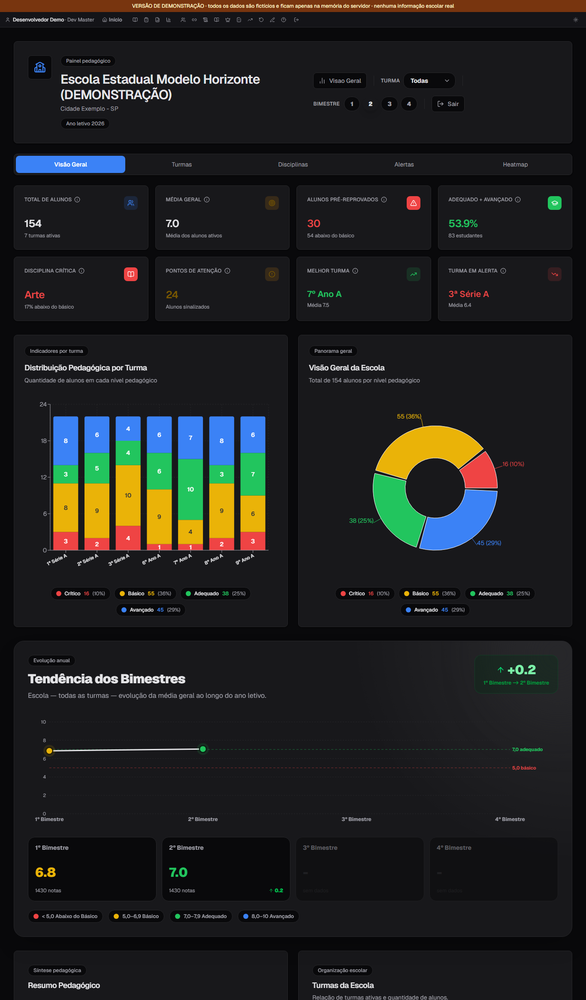
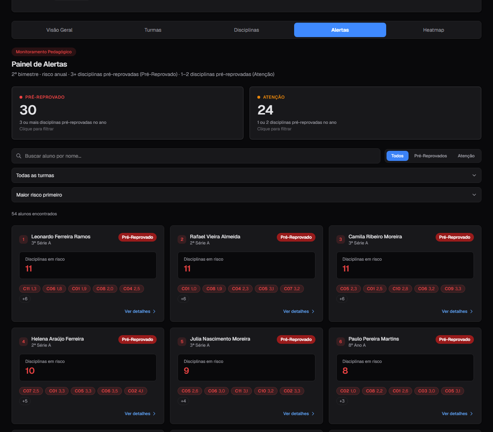
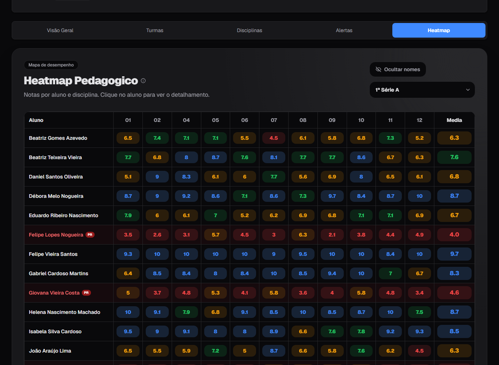
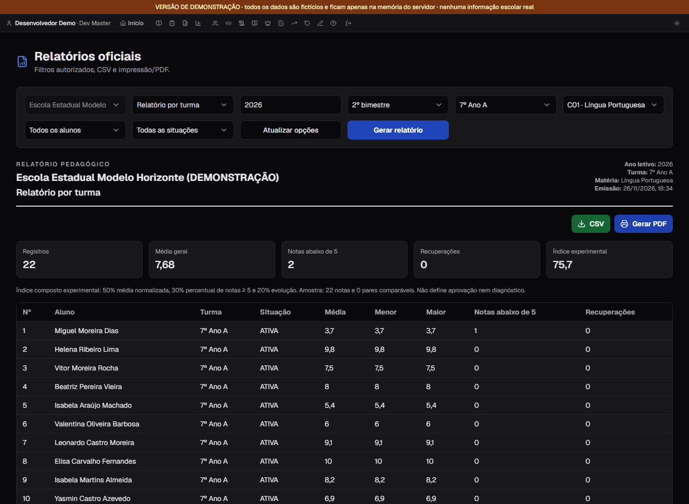
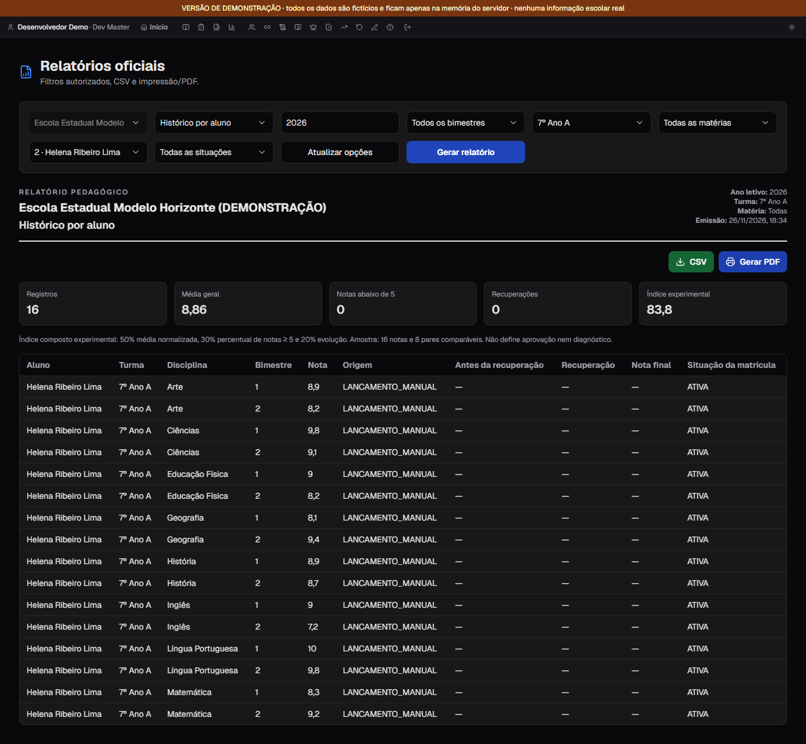
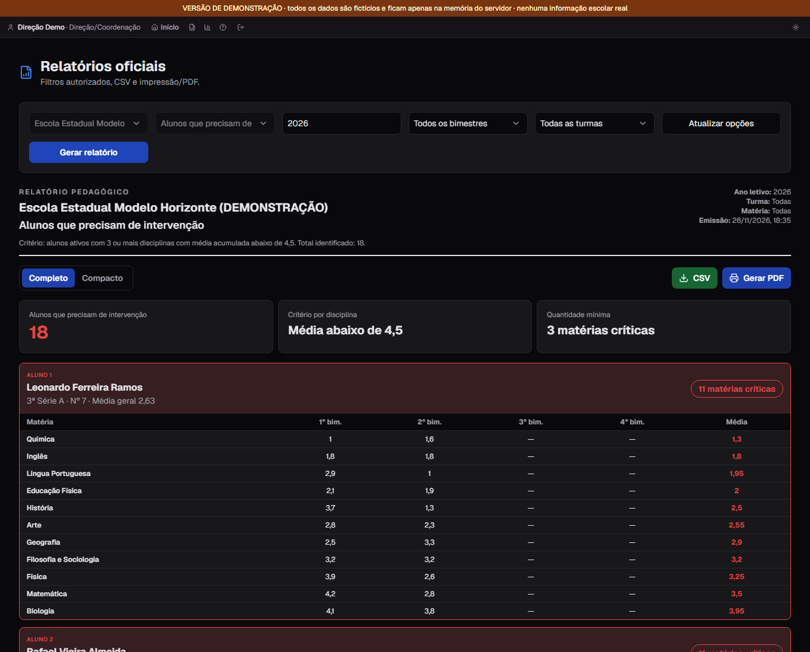
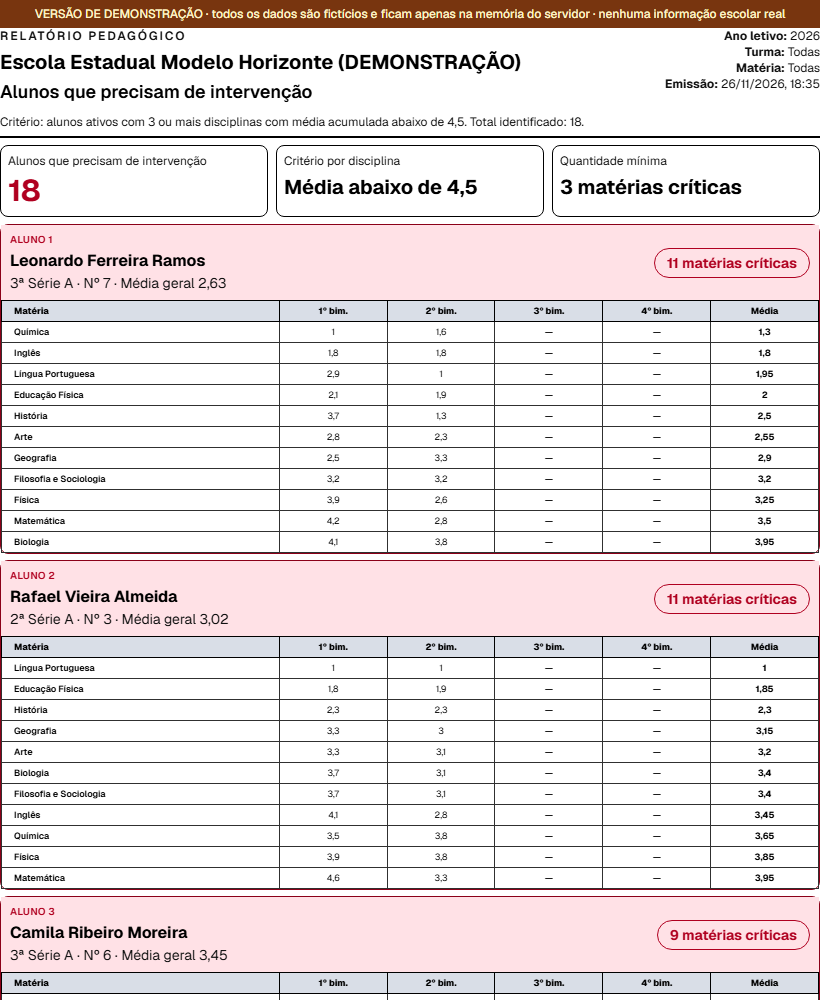
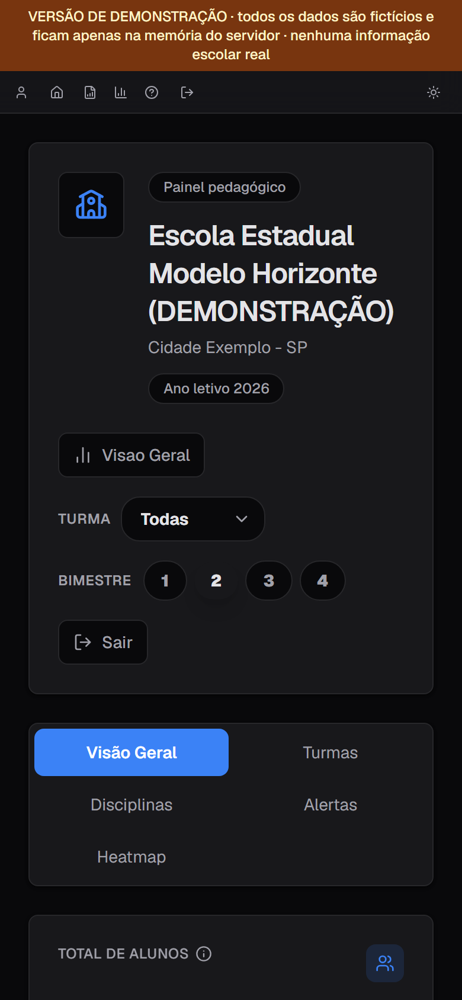

# Sistema Pedagógico

### Veja cedo quem precisa de ajuda — por turma, disciplina e aluno — e entregue à coordenação relatórios prontos para a reunião.

*Painel da escola: média geral, alunos pré-reprovados, disciplina crítica, melhor turma e a evolução bimestre a bimestre em uma única tela.*

> **Esta é a versão pública de demonstração.** Todas as telas abaixo vieram dela, com **dados 100% fictícios** ("Escola Estadual Modelo Horizonte (DEMONSTRAÇÃO)"). Uma faixa no topo avisa isso em todas as telas. O sistema oficial, em uso em uma escola, é de acesso restrito: <https://escola.andre-aguiar-jr.com.br>.

---

## Para quem é

| Direção e coordenação | Professores | Redes e gestores |
|---|---|---|
| Enxergar rapidamente quem está em risco e em quais disciplinas. | Lançar notas somente nas turmas e disciplinas atribuídas a cada professor. | Acompanhar mais de uma escola, cada uma com seus acessos. |
| Gerar relatórios oficiais em tela, **CSV** e **PDF**. | Consultar a situação dos próprios alunos. | Comparar turmas, disciplinas e bimestres. |

---

## A rotina, em quatro passos

### 1. Acompanhar a escola e as turmas

O painel resume a escola e permite filtrar por **turma** e por **bimestre**. Abas separam a **Visão Geral**, as **Turmas**, as **Disciplinas**, os **Alertas** e o **Heatmap**. Há ainda uma visão executiva com a evolução entre bimestres.

### 2. Identificar quem precisa de atenção

Os **alertas** dividem os alunos em *Pré-Reprovado* (3 ou mais disciplinas em risco) e *Atenção* (1 ou 2), mostram as disciplinas com as respectivas notas e permitem buscar por nome e filtrar por turma.

*O que você faz aqui: filtra por turma, abre "Ver detalhes" e decide quem acompanhar primeiro. O "pré-reprovado" é um alerta de acompanhamento, não uma decisão automática.*

O **mapa de notas (heatmap)** cruza alunos e disciplinas, com cores por faixa de desempenho. Há um botão para **ocultar os nomes** ao projetar a tela.

*O que você faz aqui: vê, pela cor, qual disciplina puxa a turma para baixo e quem está abaixo de 5,0.*

### 3. Lançar notas e acompanhar avaliações

- **Diário de classe** por turma, disciplina, bimestre e matrícula anual.
- **Avaliações e recuperação**, com peso e nota máxima, resultados por aluno e cálculo de recuperação validado pelo banco de dados.
- **Gestão de alunos**: cadastro, número de chamada, transferência e inativação **sem apagar o histórico**.
- **Perfil individual do aluno**: notas por disciplina e bimestre, situação e histórico.

### 4. Gerar relatórios oficiais

**Filtros preenchidos, resultado logo abaixo.** São sete tipos de relatório: por turma, por disciplina, histórico por aluno, recuperação, evolução entre bimestres, indicadores objetivos de risco e alunos que precisam de intervenção. Cada um pode ser exportado em **CSV** ou impresso em **PDF**.

*O que você faz aqui: escolhe ano, bimestre, turma e matéria, e confere média, menor e maior nota de cada aluno.*

*O que você faz aqui: abre o histórico completo de um aluno, disciplina por disciplina, para uma conversa com a família ou para o conselho.*

O relatório de **alunos que precisam de intervenção** (3 ou mais disciplinas com média acumulada abaixo de 4,5) é o único disponível para o perfil Direção/Coordenação:

**Pronto para imprimir.** Amostra do PDF do mesmo relatório:

---

## E no celular?

O painel se adapta a telas pequenas, com o menu compacto e os blocos em coluna.

---

## Tudo o que a demonstração inclui

| Recurso | O que a escola ganha |
|---|---|
| **Painéis** | Visão geral, turmas, disciplinas, alertas, heatmap e visão executiva, com filtro por turma e bimestre. |
| **Diário de classe** | Lançamento de notas por turma, disciplina, bimestre e matrícula anual. |
| **Avaliações e recuperação** | Avaliações com peso, resultados por aluno e recuperação. |
| **Alunos** | Cadastro, número de chamada, transferência e inativação preservando o histórico; perfil individual. |
| **Relatórios oficiais** | Sete tipos, filtros e exportação em **CSV** e **PDF**. |
| **Prova Paulista** | Painel da avaliação externa, **separado das notas escolares**: não entra em boletim nem em médias. |
| **Perfis de acesso** | Dev Master, Administrador Multi-Escolas, Direção/Coordenação, Professor e Somente leitura. |
| **Usuários e vínculos** | Criação, redefinição de senha e ativação/desativação; cada professor vê só as turmas e disciplinas vinculadas. |
| **Auditoria** | Registro de quem fez o quê e quando. |
| **Documentação no sistema** | Ajuda funcional dentro da própria interface. |
| **Interface** | Tema claro e escuro, layout para celular e mensagens de erro claras. |

Recursos internos do **Dev Master** (ainda em evolução): ranking de alunos, relatório de notas abaixo de 5,0, caderno particular de notas, planejamento de recuperação, projeção de notas e ajuste de notas em lote (restrito e auditado).

*Algumas telas, como a Prova Paulista, dependem de uma escola selecionada e não estão ilustradas aqui.*

### Regras pedagógicas embutidas
- **Disciplina em risco:** com menos de 4 bimestres lançados, média abaixo de 5,0; com 4 bimestres, soma anual abaixo de 20.
- **Situação do aluno:** nenhuma disciplina em risco = regular; 1 ou 2 = atenção; 3 ou mais = pré-reprovado (alerta de acompanhamento).
- **Faixas de desempenho:** abaixo de 5,0 (abaixo do básico), 5,0 a 6,9 (básico), 7,0 a 7,9 (adequado), 8,0 a 10 (avançado).

### Cuidado com os dados
Cada perfil acessa apenas a própria escola, as próprias turmas e as próprias disciplinas. Ações importantes ficam registradas na auditoria. Neste repositório público **não há nenhum dado real**: tudo é gerado e some ao reiniciar.

---

## Quer ver funcionando na sua escola?

**Solicite uma demonstração.** Mostro o sistema com dados fictícios, em uma reunião curta com a direção e a coordenação, e conversamos sobre as necessidades da sua escola.

- GitHub: [@anndrehjr](https://github.com/anndrehjr)
- Desenvolvido por **André Aguiar Jr.**

---

## Para desenvolvedores

Tecnologias, arquitetura, segurança, como executar a demonstração, testes e estrutura de pastas ficam no **[Guia técnico](docs/GUIA_TECNICO.md)**. Outros documentos: [Arquitetura](docs/ARQUITETURA.md) · [Segurança](docs/SEGURANCA.md) · [Instalação](docs/INSTALACAO.md) · [Mapeamento de funcionalidades](docs/MAPEAMENTO_FUNCIONALIDADES.md) · [Documentação funcional](docs/DOCUMENTACAO_FUNCIONAL.md)

© André Aguiar Jr. Todos os direitos reservados. O código é disponibilizado para avaliação como parte do portfólio; o uso comercial depende de autorização.
