# Guia técnico — Sistema Pedagógico (versão pública)

> Tecnologias, arquitetura, segurança, como executar a demonstração e testes. A apresentação do produto está no [README](../README.md).

Sistema web de **gestão pedagógica escolar**, criado por mim e em uso real em uma escola. Reúne diário de classe, avaliações, recuperação, relatórios oficiais, painéis de desempenho (dashboards) e controle de acesso por perfil, tudo em um só lugar.

> **Este repositório é a versão pública do projeto.** O sistema oficial é de acesso restrito e contém dados de alunos protegidos. Aqui o mesmo código roda com **dados 100% fictícios**, em um banco em memória, sem nenhuma conexão com o ambiente escolar real.

| | |
|---|---|
| **Sistema oficial** (acesso restrito) | <https://escola.andre-aguiar-jr.com.br> |
| **Este repositório** | Versão pública e sanitizada, com modo de demonstração |
| **Quer contratar ou conhecer o sistema completo?** | **Fale comigo.** Veja [Contato](#contato) |

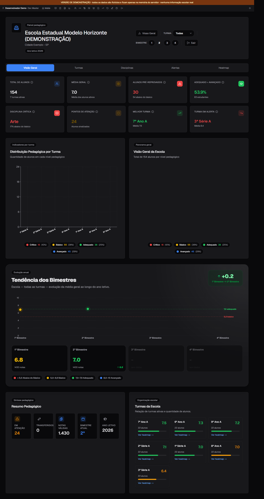

---

## Sumário

1. [Objetivo e problemas que resolve](#objetivo-e-problemas-que-resolve)
2. [Funcionalidades](#funcionalidades)
3. [Capturas de tela](#capturas-de-tela)
4. [Tecnologias](#tecnologias)
5. [Arquitetura](#arquitetura)
6. [Perfis e permissões](#perfis-e-permissões)
7. [Regras pedagógicas](#regras-pedagógicas)
8. [Segurança e proteção de dados](#segurança-e-proteção-de-dados)
9. [Como executar a demonstração](#como-executar-a-demonstração)
10. [Testes e qualidade](#testes-e-qualidade)
11. [Estrutura de diretórios](#estrutura-de-diretórios)
12. [Limitações da versão pública](#limitações-da-versão-pública)
13. [Documentação técnica](#documentação-técnica)
14. [Contato](#contato)

---

## Objetivo e problemas que resolve

Escolas costumam acompanhar notas em planilhas e atas soltas. Isso dificulta enxergar cedo quem está em risco, comparar turmas e disciplinas, e manter histórico confiável. O Sistema Pedagógico foi feito para:

- **Centralizar** matrículas, notas, avaliações e recuperações por turma, disciplina e bimestre.
- **Mostrar o desempenho** da escola, das turmas e de cada aluno em painéis claros, com alertas de risco.
- **Aplicar regras pedagógicas de forma consistente** (aluno em atenção, pré-reprovado, faixas de desempenho) em todas as telas.
- **Controlar quem vê o quê**: cada perfil acessa apenas a sua escola, as suas turmas e as suas disciplinas.
- **Deixar rastro de auditoria** das ações importantes (lançamento de notas, redefinição de senha, exportação de relatórios).
- **Gerar relatórios oficiais** filtráveis, exportáveis em CSV e prontos para impressão ou PDF.

## Funcionalidades

Todos os módulos abaixo existem no código deste repositório e abrem na demonstração. O detalhamento de cada um (rotas, perfis, APIs e tabelas) está em [`docs/MAPEAMENTO_FUNCIONALIDADES.md`](./MAPEAMENTO_FUNCIONALIDADES.md).

**Painéis e indicadores**
- **Painel pedagógico da escola** com abas *Visão Geral*, *Turmas*, *Disciplinas*, *Alertas* e *Heatmap*, filtro por turma e por bimestre.
- **Visão executiva** (`/analytics`): média geral, alunos pré-reprovados, zona de atenção, melhor/pior disciplina e turma, evolução entre bimestres, separação Ensino Fundamental e Médio.
- **Heatmap pedagógico**: mapa de notas por aluno e disciplina, com cores por faixa de desempenho.
- **Perfil individual do aluno**: notas por disciplina e bimestre, situação e histórico.

**Rotina de sala de aula**
- **Diário de classe**: lançamento de notas por turma, disciplina, bimestre e matrícula anual.
- **Avaliações e recuperação**: avaliações com peso e nota máxima, resultados por aluno e recuperação com cálculo validado pelo banco.
- **Gestão de alunos**: cadastro, número de chamada, transferência e inativação sem apagar histórico.

**Administração**
- **Usuários**: criação, redefinição de senha, ativação e desativação, respeitando a hierarquia de perfis.
- **Vínculos de professores**: cada professor enxerga somente as turmas e disciplinas que lhe foram atribuídas.
- **Logs de auditoria**: quem fez o quê e quando.
- **Ajuste de notas em lote**: recurso restrito, transacional e auditado.

**Relatórios**
- **Relatórios oficiais** filtráveis, com exportação em CSV e impressão/PDF.
- **Prova Paulista**: painel separado da avaliação externa (não entra no boletim nem nas médias).
- **Documentação funcional dentro do próprio sistema**.

**Recursos internos do Dev Master** (ainda não expostos aos demais perfis): ranking de alunos, relatório de notas abaixo de 5,0, caderno particular de notas, planejamento de recuperação e projeção de notas.

**Interface**: tema claro/escuro, layout responsivo para celular, animações leves, atalhos por perfil e mensagens de erro claras.

## Capturas de tela

As imagens abaixo foram geradas **a partir da demonstração**, portanto mostram apenas dados fictícios.

| | |
|---|---|
| 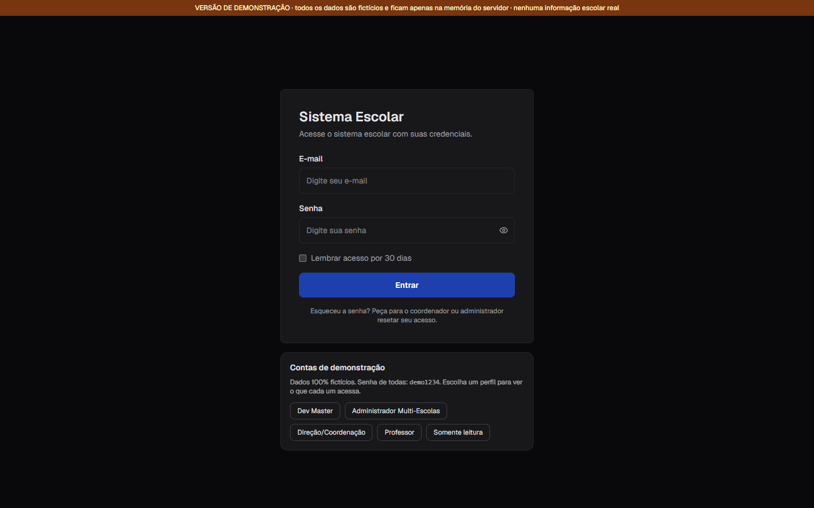 **Login** com atalho para as contas de demonstração | 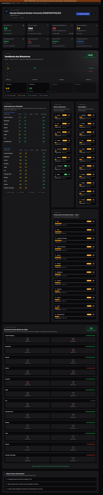 **Visão executiva** |
| 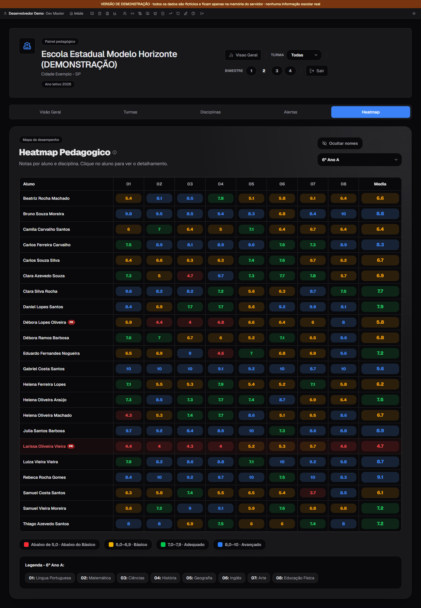 **Heatmap pedagógico** | 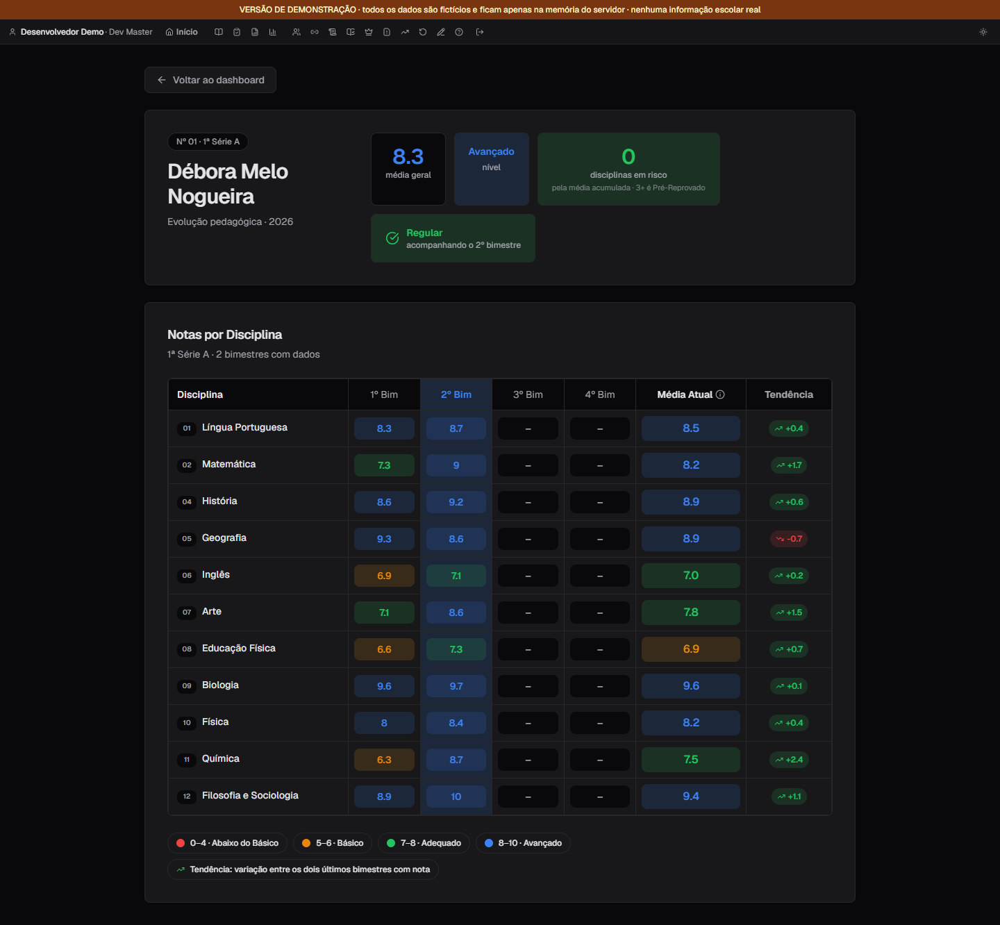 **Perfil individual do aluno** |
| 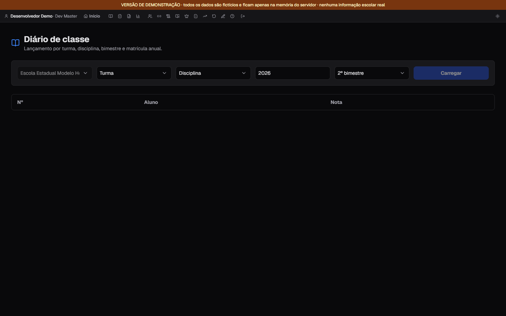 **Diário de classe** | 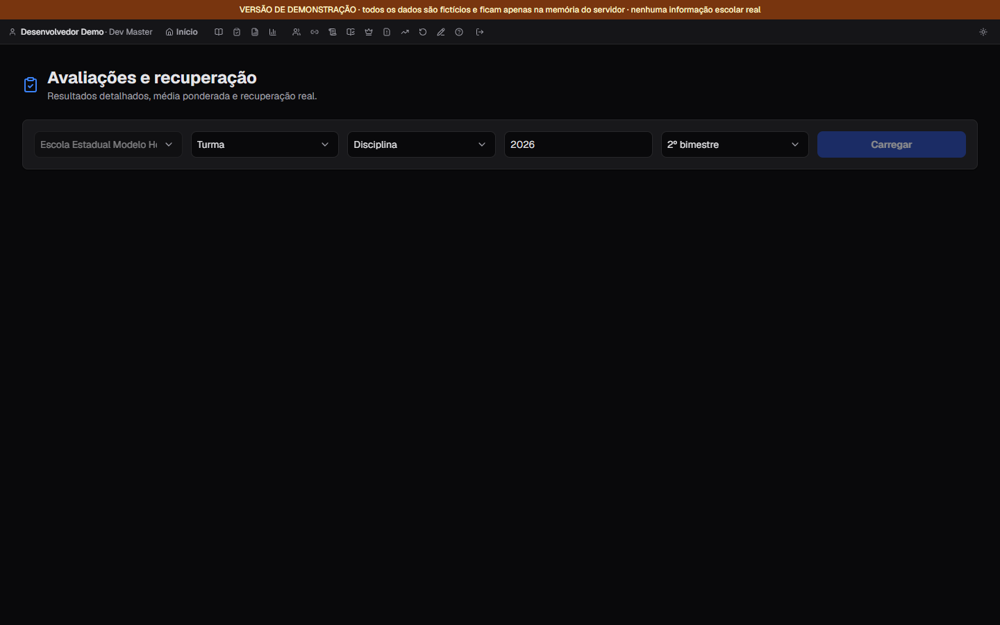 **Avaliações e recuperação** |
| 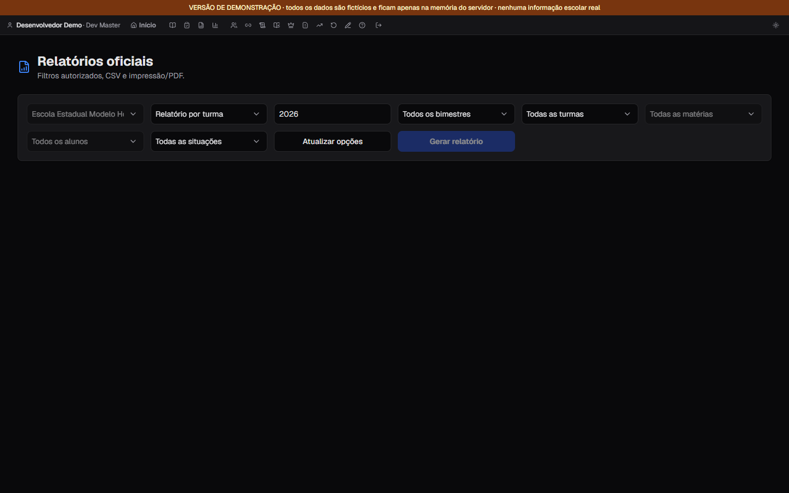 **Relatórios oficiais** | 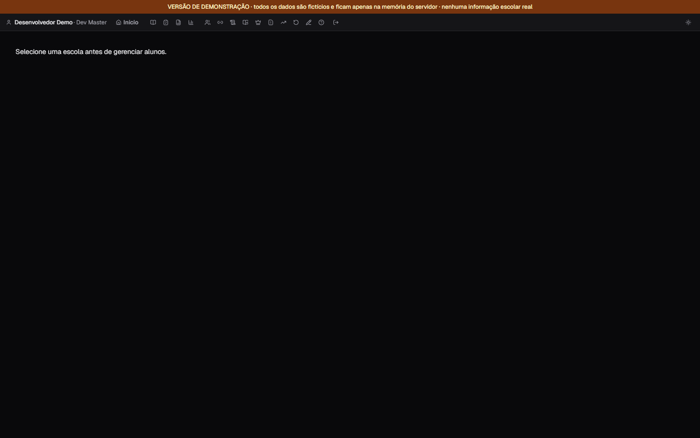 **Gestão de alunos** |
| 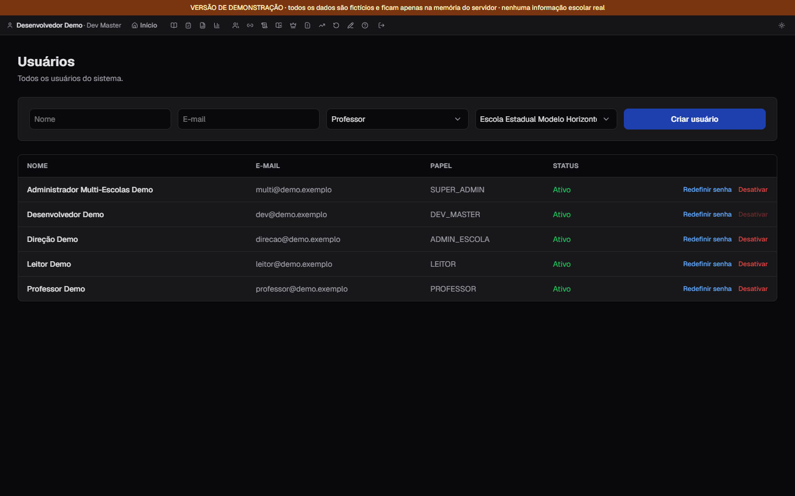 **Usuários** | 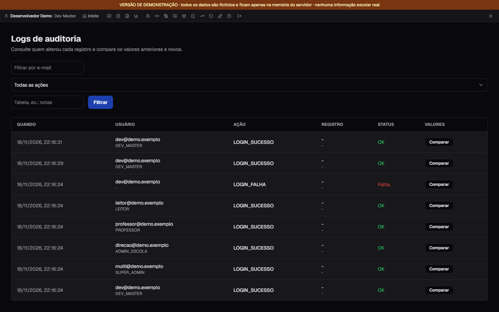 **Logs de auditoria** |
| 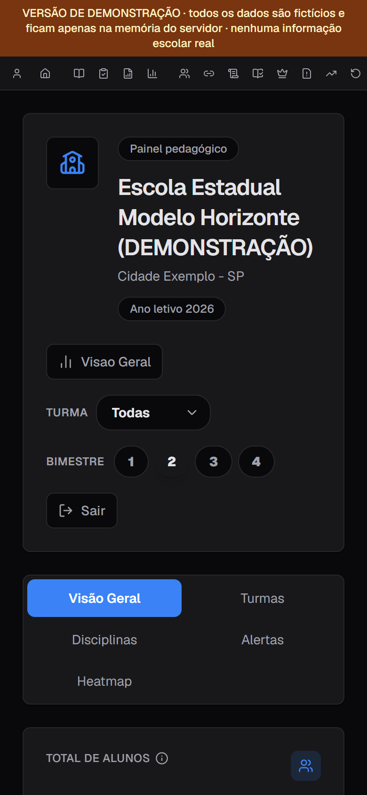 **Celular: painel** | 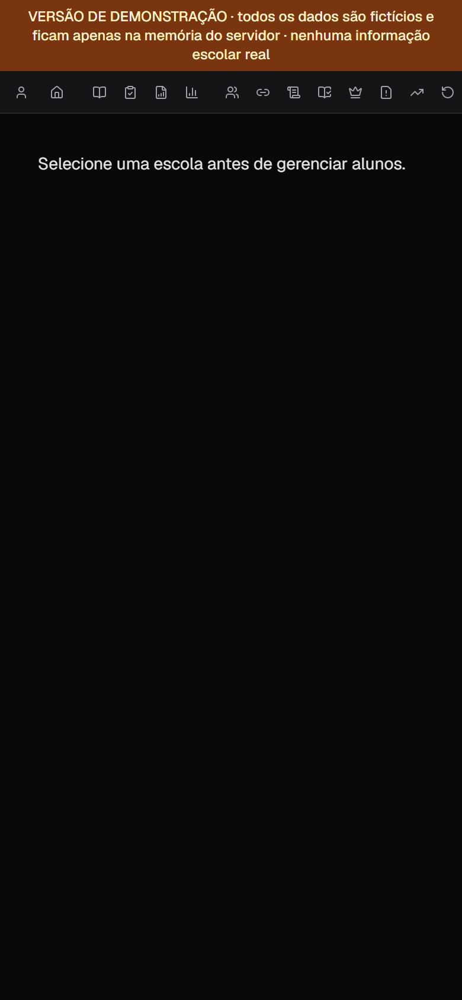 **Celular: alunos** |

A galeria completa está em [`docs/screenshots/`](screenshots/).

## Tecnologias

Somente o que o projeto realmente usa (versões do `package.json`):

| Camada | Tecnologia |
|---|---|
| Framework | **Next.js 16** (App Router, rotas de API, middleware) |
| Interface | **React 19**, **TypeScript 5**, **Tailwind CSS 4** |
| Gráficos e animação | **Recharts 3**, **Motion**, **lucide-react** (ícones) |
| Conteúdo | **react-markdown** + **remark-gfm** (documentação dentro do sistema) |
| Banco de dados (produção) | **PostgreSQL 16**, com restrições `CHECK`, chaves estrangeiras e **gatilhos (triggers) em PL/pgSQL** |
| Banco de dados (demonstração) | **PGlite** (PostgreSQL em WebAssembly, em memória) |
| Autenticação | Sessão por **JWT** (`jose`) em cookie `httpOnly`, senhas com **bcrypt** (`bcryptjs`) |
| Planilhas | **fflate** (leitura de arquivos `.xlsx` da Prova Paulista) |
| Testes | **node:test** executado com **tsx** (72 testes); **Playwright** disponível para testes de tela |
| Qualidade | **ESLint 9**, **TypeScript** em modo estrito |
| Implantação (oficial) | **Docker** (imagem Node 24 Alpine, usuário sem privilégios) em **VPS** própria |

## Arquitetura

```
 Navegador ──► Next.js (App Router)
                 ├─ Páginas (Server Components) ──┐
                 ├─ Componentes de interface       │ consultas SQL
                 ├─ Middleware (sessão/cookie)     ▼
                 └─ Rotas /api/* (30 endpoints) ─► Camada de banco (src/lib/db.ts)
                                                      ├─ Produção:  PostgreSQL 16 (biblioteca `postgres`)
                                                      └─ Este repo: PGlite em memória + dados fictícios
```

Pontos de projeto que valem destaque:

- **Regras no banco, não só na tela.** Gatilhos validam escopo da escola, vínculo de professor, matrícula da nota e cálculo de recuperação. Mesmo uma chamada de API errada não consegue gravar dado inconsistente.
- **Camada de banco substituível.** O código usa consultas SQL em *template string* tipadas. Na versão pública, o mesmo código roda sobre um PostgreSQL em memória, **sem alterar as consultas**.
- **Permissões em uma única matriz** (`src/types/roles.ts`), compartilhada por menus, páginas e APIs.
- **Transações** para operações com várias gravações (cadastro de aluno, lançamento de resultados, ajuste em lote).

Detalhes em [`docs/ARQUITETURA.md`](./ARQUITETURA.md).

## Perfis e permissões

| Perfil | Escolas | Turmas | Notas e avaliações | Usuários e vínculos | Auditoria |
|---|---|---|---|---|---|
| Dev Master | Todas | Todas | Completo | Completo | Sim |
| Administrador Multi-Escolas | Todas | Todas | Completo | Completo, dentro da hierarquia | Sim |
| Direção/Coordenação | Própria | Todas da escola | Completo | Professores e leitores da escola | Não |
| Professor | Própria | Só as vinculadas | Só as disciplinas vinculadas | Não | Não |
| Somente leitura | Própria | Todas da escola | Consulta | Não | Não |

Um usuário nunca administra um perfil acima do próprio nível.

## Regras pedagógicas

- **Disciplina em risco:** com menos de 4 bimestres lançados, média abaixo de 5,0; com 4 bimestres, soma anual abaixo de 20.
- **Situação do aluno:** nenhuma disciplina em risco = regular; 1 ou 2 = atenção; 3 ou mais = *pré-reprovado* (alerta de acompanhamento, **não** é decisão automática).
- **Faixas de desempenho:** abaixo de 5,0 (abaixo do básico), 5,0 a 6,9 (básico), 7,0 a 7,9 (adequado), 8,0 a 10 (avançado).
- Alunos transferidos não entram nos indicadores de alunos ativos; notas nulas ou inválidas não entram nos cálculos.

## Segurança e proteção de dados

O sistema oficial lida com dados de menores, então a proteção é prioridade.

**No sistema oficial:** senhas com bcrypt, sessões JWT em cookie `httpOnly`, bloqueio após 5 tentativas inválidas em 15 minutos, revogação de sessões ao redefinir senha ou desativar usuário, validação de entrada nas rotas de escrita, consultas parametrizadas, escopo por escola/turma/disciplina em cada consulta, cabeçalhos de segurança (CSP, HSTS, `X-Frame-Options`, `Referrer-Policy`) e trilha de auditoria.

**Neste repositório público:**

- **Nenhum dado real** de alunos, responsáveis, professores ou escola. Tudo é gerado por um sorteador com semente fixa (`src/demo/seed.ts`).
- **Nenhuma credencial**: não há `.env` real, e o `.env.example` traz só variáveis ilustrativas.
- **Nenhuma conexão externa**: o banco existe apenas na memória do processo e some ao reiniciar.
- **As contas de demonstração e a senha são públicas de propósito** e só valem para o banco fictício.
- Uma faixa visível em todas as telas avisa que se trata de demonstração.
- Arquivos de importação de dados escolares, rotinas de backup e documentação operacional **não foram incluídos**.

Mais em [`docs/SEGURANCA.md`](./SEGURANCA.md).

## Como executar a demonstração

Requisitos: **Node.js 20 ou superior** (o oficial roda em Node 24) e **npm**.

```bash
git clone https://github.com/anndrehjr/Sistema-Pedagogico.git
cd Sistema-Pedagogico
npm install
npm run dev
```

Abra <http://localhost:3000> e use um dos atalhos da tela de login. Todas as contas usam a senha `demo1234`:

| Conta | Perfil |
|---|---|
| `dev@demo.exemplo` | Dev Master (vê todos os módulos) |
| `multi@demo.exemplo` | Administrador Multi-Escolas |
| `direcao@demo.exemplo` | Direção/Coordenação |
| `professor@demo.exemplo` | Professor (turmas do Fundamental, Português e Matemática) |
| `leitor@demo.exemplo` | Somente leitura |

Para gerar a versão de produção: `npm run build && npm start`. Detalhes e variáveis em [`docs/INSTALACAO.md`](./INSTALACAO.md).

> As alterações feitas na demonstração (por exemplo, cadastrar um aluno) valem só enquanto o servidor estiver ligado. Ao reiniciar, os dados voltam ao estado inicial.

## Testes e qualidade

```bash
npm test          # 72 testes (regras pedagógicas, permissões, sessão, relatórios, banco de demonstração)
npm run lint      # ESLint
npx tsc --noEmit  # verificação de tipos
npm run build     # build de produção
```

Na versão pública foram verificados, além dos testes: login dos 5 perfis, recusa de senha errada, 41 rotas e páginas sem erro de servidor, cadastro de aluno com transação e regra de número de chamada, bloqueio de perfis sem permissão e ausência de rolagem horizontal no celular.

## Estrutura de diretórios

```
src/
  app/            páginas e rotas de API (App Router)
  components/     componentes de interface e painéis
  lib/            regras de negócio, autenticação, banco, relatórios
  demo/           esquema do banco, dados fictícios e testes da demonstração
  services/       sessão e autenticação no cliente
  types/          tipos e matriz de permissões
sql/              migrações históricas do banco oficial (referência)
docs/             documentação técnica e capturas de tela
```

Árvore comentada em [`docs/ESTRUTURA_PROJETO.md`](./ESTRUTURA_PROJETO.md).

## Limitações da versão pública

- Os dados são fictícios e reiniciam a cada execução; **não há persistência**.
- Não há importação de dados escolares reais, backup externo nem integrações do ambiente oficial (essas rotinas não fazem parte deste repositório).
- A **Prova Paulista** abre e consulta com os dados fictícios; a importação de planilhas reais não foi exercitada na demonstração.
- Os módulos exclusivos do Dev Master existem e abrem, mas são recursos internos em evolução.
- O ajuste de notas em lote é restrito: só o Dev Master (ou uma conta Multi-Escolas cujo e-mail conste na variável `AJUSTE_NOTAS_EMAILS`) o acessa.

## Documentação técnica

- [`docs/ARQUITETURA.md`](./ARQUITETURA.md)
- [`docs/MAPEAMENTO_FUNCIONALIDADES.md`](./MAPEAMENTO_FUNCIONALIDADES.md)
- [`docs/SEGURANCA.md`](./SEGURANCA.md)
- [`docs/INSTALACAO.md`](./INSTALACAO.md)
- [`docs/ESTRUTURA_PROJETO.md`](./ESTRUTURA_PROJETO.md)
- [`docs/DOCUMENTACAO_FUNCIONAL.md`](./DOCUMENTACAO_FUNCIONAL.md) (a mesma exibida dentro do sistema)

## Contato

Este código é uma **amostra do meu trabalho**. O sistema completo, em produção, é de acesso restrito.

**Se você quer contratar, adaptar o sistema para a sua escola ou conversar sobre o projeto, fale comigo:**

- GitHub: [@anndrehjr](https://github.com/anndrehjr)
- Desenvolvido por **André Aguiar Jr.**

© André Aguiar Jr. Todos os direitos reservados. O código é disponibilizado para avaliação como parte do portfólio; o uso comercial depende de autorização.
